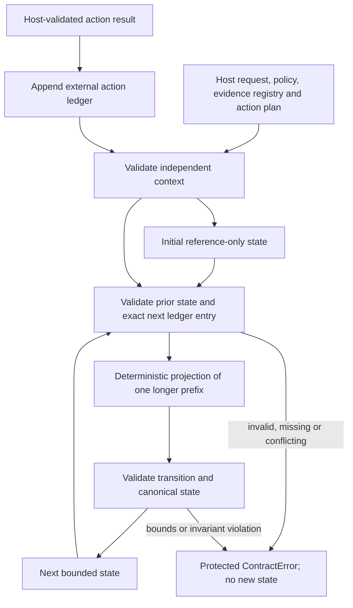

# ADR: validated semantic state before Single-Action Compaction

Status: experimental P0/P1 foundation; P2 execution integration deferred.
Issue: [#19](https://github.com/rajesamp/CRA2/issues/19).
Date: 2026-11-05.

## Context and decision

CRA2's current LangGraph workflow is a bounded directed graph with ephemeral
execution state. It is not an autonomous multi-action model loop. The local
evidence path does not call a model. Compacting this graph alone cannot establish
model-context, cost, quality or latency benefits from Single-Action Compaction
(SAC).

First introduce an independently validated, bounded execution-state contract and
a pure deterministic reducer. Measure the current graph through optional local
observation. Keep the new reducer standalone until a later change supplies
explicit action boundaries and fresh per-action model inputs. Do not add a
`CRA2_CONTEXT_MODE` selector until those execution modes actually exist.

The public CLI, Gradio, Slack and workflow defaults continue to use the existing
execution path. Team preference storage and its policy precedence are unchanged;
there is no graph checkpoint persistence or new external tool.

## Authority and storage boundaries

| Data | Owner and use |
| --- | --- |
| Validated original objective, change ID and service | Host request identity; state must match it exactly. |
| Authoritative policy and its digest/references | Host-owned configuration; never edited by compact state. |
| Original retrieved evidence and validated tool results | External host evidence registry; state carries allow-listed IDs. |
| Action plan and validated action-result ledger | Host-owned execution record; determines permitted next action and replay prefix. |
| Question records | External registry; compact state retains unresolved question IDs. |
| Semantic state | Ephemeral bounded projection, with versions, references and provenance digests. |
| Complete audit record | Outside compact model context; this foundation does not introduce durable audit storage. |
| Team preference memory | Existing bounded store; separate from execution state and policy authority. |

The host context is a trusted collaborator, not model-editable data. A future
integration must build it from the original validated request, policy and actual
tool/retrieval outputs, and retain it independently. Passing a model's proposed
context as the authoritative context would defeat this boundary. Digests bind a
state to its context and ledger prefix; they are **not signatures** and do not
establish authenticity without that independent host authority.

The compact state contains no free-form conclusions, risk decisions, approval
status, executable preference notes, owner records, raw provider prompts or raw
tool transcripts. Its objective is the bounded original task identity. Text in
that objective remains data. `next_action` is one of a closed set of action names,
not an executable command or authorization.

## State transition



`week2/semantic_state.py` defines schema and reducer versions, closed fields,
stable JSON and public validation/serialization boundaries. State is capped at
16 KiB UTF-8, 32 completed actions and 64 references per reference list. Unknown
fields, duplicate JSON keys, invalid versions, controls, non-finite values and
oversized data are rejected. Arrays of evidence, policies and unresolved question
references have canonical ordering; completed actions retain execution order.

`week2/compaction.py` projects only independently recorded successful action
results. `initial_state(context)` binds the initial state to the host's identity,
policy and plan. `reduce_state(previous, action_result, context)` accepts the
exact next action in the external ledger, then validates the whole resulting
projection. The ledger must be exactly one action ahead of the prior state;
stale prefixes cannot rewind execution. Historical prefixes can still be loaded
for audit, but cannot be reduced against a more advanced ledger. Public loaders
require the same independent context; shape validation
alone is not trust validation. Serialization is deterministic for identical
validated inputs. Inputs are copied, not mutated.

The reducer cannot execute tools, call a model, change policies or make a risk
assessment. Unsupported evidence, service substitution, out-of-order/duplicate
actions, ledger conflicts, malformed state and capacity overflow raise protected
errors. The previous state remains available unchanged. There is no automatic
fallback to a less constrained summary, fabricated result or silent truncation.
A future host must stop the experimental path and present a safe unavailable
result or explicitly restart from original validated records.

## Safety contracts

Existing citation allow-lists, the configured medium-risk floor and human-only
change decisions remain owned by the current assessment workflow. P1 does not
replace those checks. Reference provenance must remain consistent with the
original service and evidence source. A synthetic health snapshot never becomes
verified production health; unknown freshness and active incidents remain
unknown, and a reported freeze remains unconfirmed. Compact state cannot promote
these into authoritative policy or approval.

Evidence records, policy snapshots and complete action records remain external so
future action-context construction can resolve and independently check each
reference. P1 does not claim an immutable audit store, signed provenance, runtime
step deadlines or complete prompt-injection prevention. Those are separate host
responsibilities and later integration work.

## Baseline observation and reproducibility

`build_workflow(observer=callback)` and the existing `respond`/`arespond`
collaborator arguments opt into in-process observation. The observer receives
fresh measurement records containing fixed action labels, elapsed wall time,
completion/failure status, tool-call counts and typed provider usage metadata.
No graph state, question, evidence text, policy record, result body or exception
message enters an observation event. Events are not inserted into the graph,
public trace or model context; no network exporter or persistence is added.

The callback is trusted synchronous host code. It must be fast, store events responsibly and
not perform external actions. Callback exceptions are ignored to preserve the
advisory result. Missing observer records are therefore missing telemetry, not
proof that an action did not run. Node completion means the node returned; it
does not mean the workflow produced a successful assessment. A guarded
`tools_unavailable` return can have completed nodes. Provider events identify
injected reviewers separately from the built-in Groq adapter, and numeric usage
is explicitly reviewer-reported. Unknown request/usage metadata remains null;
an injected reviewer is not evidence of a real provider call. Node and provider
times are nested and must not be summed.

`scripts/benchmark_sac.py` pairs observer-off and observer-on executions of the
same seven versioned fixtures in `evals/sac-baseline.json`. It alternates pair
order, checks identical guarded output after removing request/session IDs, and
checks repeats. It exercises the actual graph and read-only tool functions with
fixed synthetic retrieval and isolated empty preference memory. MCP transport,
embedding retrieval and live providers are outside this workload.

```sh
uv run --locked --offline --project week2 python scripts/benchmark_sac.py \
  --repeat 5 --out /tmp/cra2-sac-baseline.json
```

Choose a new output path each time; reports use exclusive creation rather than
overwrite existing evidence. Each report includes run/time identity, Git SHA,
dirty-tree status, source-file hashes, dataset version/hash, fixed configuration
and its hash, Python version, per-run measurements, parity checks and nearest-rank
p50/p95 latency. The configuration includes digests of actually loaded policy,
catalog and rules, including externally configured inputs, without exporting
their values or paths. Local runs record zero provider requests and null token, cost,
peak-context, compaction-overhead and risk-agreement measurements. This baseline
can detect observer regressions; it cannot show SAC effectiveness. See
[the evidence report](evidence/sac-benchmark.md) for measured results and limits.

## Alternatives and remaining work

Free-form model summaries were rejected for the first implementation because
they add unsupported claims, nondeterminism and another trust boundary. Copying
policy into editable state was rejected because it confuses a reference with
authority. Discarding original evidence/audit records was rejected because
compaction must preserve independent verification and recovery.

P2 must integrate a feature-flagged per-action host, fresh context construction,
externally resolved references, cancellation/deadlines, strict step budgets and
terminal conditions. P3 must compare full, threshold and SAC modes on identical
genuine multi-step workloads, add integration/adversarial recovery tests, and
measure provider usage, peak context, compaction overhead, failures and decision
quality. Paid live-provider runs require separate explicit authorization. P4
documentation/publication must distinguish measured CRA2 results from research
claims. No cost savings, quality parity or production reliability are claimed by
this foundation.
