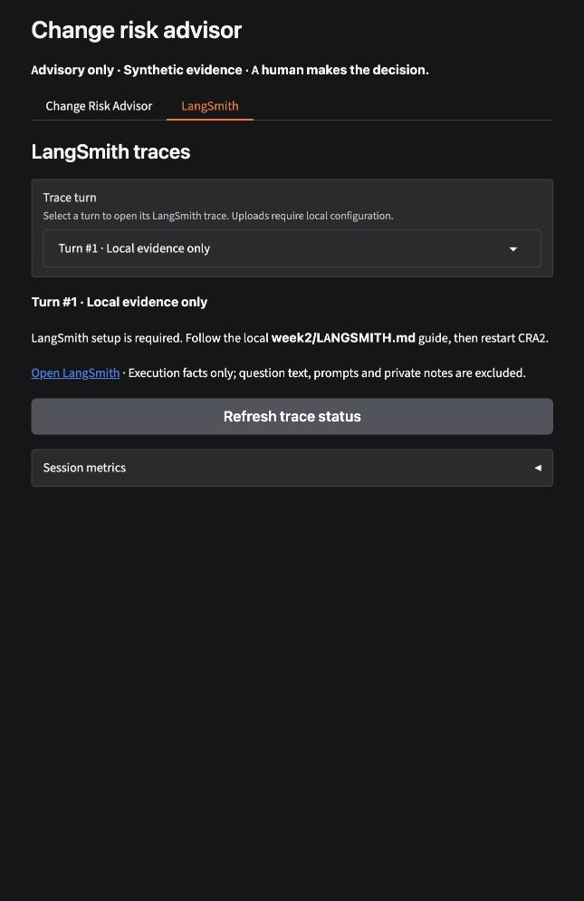
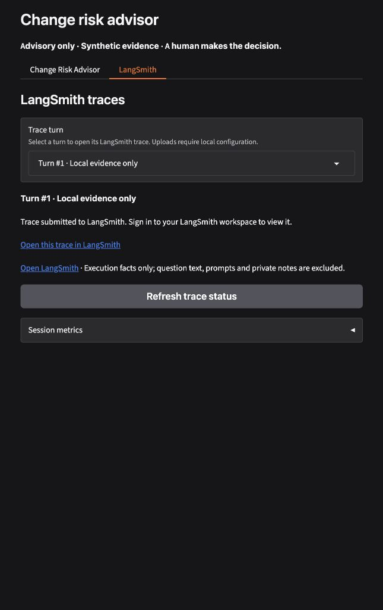

# LangSmith trace showcase — verified 2026-11-05

Scope: replace Admin/PIN trace UI with opt-in private LangSmith browser traces.
Existing Week 3–4 local behavior, Slack separation and owner records remain.
Current implementation baseline was `22dcfca`. No new dependency was installed.

## Verification

- Final Week 2–4 integration gate: **289 passed** in 86.98 seconds, including
  **20 LangSmith cases**. The 143 warnings are dependency deprecations.
- Final offline-environment isolation check: **21 passed** in 9.12 seconds
  with a fake exported key/enable flag, proving UI regression fixtures keep
  implicit uploads disabled while explicit fake SDK sinks remain testable.
- Unchanged core: **502 passed, 4 live tests deselected** in 6.86 seconds.
- Unchanged Week 1: **494 passed** in 10.05 seconds.
- Fast core calibration: **100/100 assessments**, 20 cases x 5 repeats,
  minimum rubric 10/10; no provider request attempts.
- Week 4 local scorecard: **18/18**, provider attempts 0.

The LangSmith tests execute real NeMo, team memory and MCP. A controlled SDK
sink verifies grouped root/node/tool/rail runs and original turn/mode. A repeated
cached graph query has no new tool span and zero actual MCP attempts. Separate
tests send the projected tree through the real SDK with a stubbed HTTP adapter;
HTTP 401 ingestion is detected through the SDK error callback. Failure cannot
be mislabeled submitted. No actual LangSmith receipt is established by mocks.

Private canaries in questions, answers, prompts, history, passages, team identity
and saved notes are absent from exported payloads. Known-key input is rejected
before work. Unsafe URLs are withheld; queue overload is bounded; upload/URL
failure does not change the advisory answer. Actual Gradio serialization keeps
raw snapshots in server State even when client inputs try to forge it.

The first transport-stub attempt exposed that SDK construction replaces session
adapters and batch ingestion can log rather than raise. The final test installs
the adapter after construction, and the exporter checks the error callback.
That initial fake-key attempt failed DNS in the restricted environment; it
did not establish cloud access or upload application data. Current tests use
the controlled adapter and never need a real key.

## Browser proof

Launched the intended CRA2 loopback app on port 7862. A real browser question,
`What services depend on payment-gateway?`, completed in Local evidence only
with an actual MCP graph call and cache miss. The adjacent tab is **LangSmith**;
the old Admin/PIN controls and raw JSON viewer are absent. Turn #1 retains its
original local mode. The screenshot truthfully shows **setup required** because
private LangSmith configuration was not available at launch.

The owner requested the private `.env` editor. Missing trace-enable/key fields
were appended without showing/replacing existing credentials; permissions are
0600. The key line was opened through the app's file panel. Setup instructions
cover both project-based and agent-based workspaces.

## Approved live application verification

The owner saved the API key in private `.env`. Configuration validation found
the key and valid US/project settings without printing values. Automatic
approval review rejected the proposed app trace transmission because the
memory-policy, retrieval and tool fields needed explicit data/destination
authorization. No rejected command was executed or retried indirectly.

A separately reviewed safer probe contained only the fixed name
`CRA2 connectivity check`, `inputs={"check":"connectivity"}` and
`outputs={"status":"ok"}`, with generated IDs/timestamps. It was accepted by
LangSmith and read back successfully after ingestion propagation. This proves
authentication and connectivity; it does not establish app trace receipt.
The private receipt is ignored at `week2/.local/langsmith-connectivity.json`.
No private application content, service facts, memory policy or RAG data was
included in that probe. No public trace link was created.

The owner subsequently explicitly approved memory recall/effective flags,
source IDs/scores, validated synthetic MCP inputs/results, cache/rail outcomes,
timing and request/thread/turn IDs for the configured LangSmith workspace.
The private enable flag was then set true and the intended app restarted.
Questions, answers, prompts, passages, saved notes, credentials and owner audit
remain excluded; no public trace share was created.

The real browser question about changing checkout-service timeout from four
seconds to 400 milliseconds completed in Local evidence only. SDK readback of
that same request verified one root with **11 descendants**, including **two
actual MCP tool spans** and **three NeMo guardrail spans**, **three retrieved
source IDs/scores**, **memory.status = recalled**, and **no provider attempt**.
The exported inputs/outputs/metadata contained neither the question nor any of
the **six configured sensitive values** checked. Private receipts stay ignored
under `week2/.local/`; account, workspace and run identifiers are not published.

A real-SDK regression exposed in-place mutation of submitted IDs and timestamps.
The exporter now deep-copies the reviewed tree before ingestion. The regression
failed before that change and passed afterward. URL resolution also has a
private SDK fallback and a distinct in-progress status. The actual browser now
shows **Trace submitted** and **Open this trace in LangSmith** for its original
turn/mode. Following the link requires the configured LangSmith sign-in.

## Publication checks

The owner requested a GitHub update with secrets excluded. Private `.env` and
`.env.slack` remain ignored with 0600 permissions. Private learner notes,
SQLite state, logs and verification receipts stay outside publication. The
public `.env.example` contains blank keys and disabled export by default.

The publication snapshot and outgoing history are checked with configured-value
matching and Gitleaks 8.30.1 using its default rules, an empty ignore file and
redacted reports. Positive canaries establish detection. Three snapshot alerts
are reviewed public model-artifact SHA256 checksums in unchanged Week 1 setup
code; no scanner rule was disabled. Two older planning documents now reference
local operating directives without exposing an absolute personal path. This
does not rewrite older Git history.

Pre-commit inventory: **27 selected changed/new files**, a **247-file** public
snapshot, and **20 previously unpublished commits**. Configured-value matching
covered the current tree/outgoing versions; the full reachable-history check
covered **86 commits and 471 blob versions**, with **zero matches** to six
configured sensitive values. Full-history Gitleaks produced six alerts, all
reviewed public SHA256 checksums; no unreviewed finding remained. Staged blobs
were separately checked: **0 Gitleaks findings in 27 staged files**, and
**0 private paths among 247 tracked files**. The final outgoing branch receives
an additional publication gate. These
checks are bounded evidence, not a guarantee against every possible secret.
