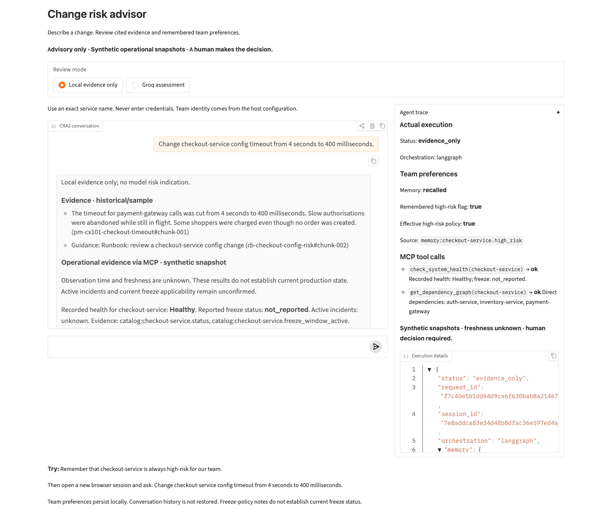

# Task 18: real Gradio/MCP/memory browser walkthrough

Executed at `2026-10-18T03:29:35.556Z` (17 Oct 2026 America/Chicago).
The actual loopback Gradio app was exercised using installed Chrome and two
independent browser contexts. External browser requests were blocked. The app
used Local evidence only; no new provider call was made.

## Session A: explicit preference write

- Browser-generated session: `df9ec8d3a64c4df49a715841892a5442`.
- Input: Remember that checkout-service is always high-risk for our team.
- Observed status: memory_saved; persisted high-risk flag true.
- No retrieval, MCP or provider work was required for this write.

## Session B: new visit, no shared chat history

- Browser-generated session: `7e8addca83e34d48b8dfac36e597ed4a`; distinct from session A.
- Before input, the new browser context contained no prior conversation.
- Input: Change checkout-service config timeout from 4 seconds to 400 milliseconds.
- Observed status: evidence_only; recalled high-risk flag true, effective flag true.
- Actual MCP calls: check_system_health(checkout-service), get_dependency_graph(checkout-service).
- Recorded health: Healthy; freeze report: not_reported, applicability unconfirmed.
- Direct dependencies: auth-service, inventory-service, payment-gateway.
- Historical passages, source IDs, snapshot uncertainty and advisory reminder
  appeared in the actual chat response.

## Expanded panel screenshot



The screenshot was inspected. An initial component placement issue had moved
chat below the trace; it was corrected before this final capture. The final
image shows the actual chat beside the expanded panel, recalled policy and
both MCP results. The JSON panel contains only the projected trace; it is not
a raw SDK/graph-state dump. Full browser transcripts remain in ignored
`week2/.local/task18-browser.json`. The test server and browser were stopped.

## Final verification

```text
Week 2: 86 passed in 30.60s
Core: 502 passed, 4 live tests deselected in 4.66s
Unchanged Week 1 tests inside Week 2 environment: 494 passed in 7.39s
Final UI layout checks: 4 passed in 4.45s
Repeated fast evaluation: 100/100, minimum rubric 10/10, 20/20 contexts repeatable
Provider attempts in final fast evaluation: 0
```

Evaluation UTC window: 2026-10-18T03:28:18.685476+00:00 to
2026-10-18T03:28:18.748985+00:00. These checks do not establish production
accuracy, multi-user authentication or current operational health.

The implementation remains local and advisory. Team identity comes from host
configuration. Storage and credentials are not served as files. Preference
records are team/service scoped; freeze notes remain inert, unverified policy
text. The existing medium floor for a high-risk policy is preserved; local
mode assigns no model risk rating. Persistent conversation history, public
sharing/deployment, and Weeks 3–4 remain outside this completion.

Launch: `week2/.venv/bin/python -m week2.app` from the repository root, then
open `http://127.0.0.1:7862`. Expand Agent trace after submitting a query.
