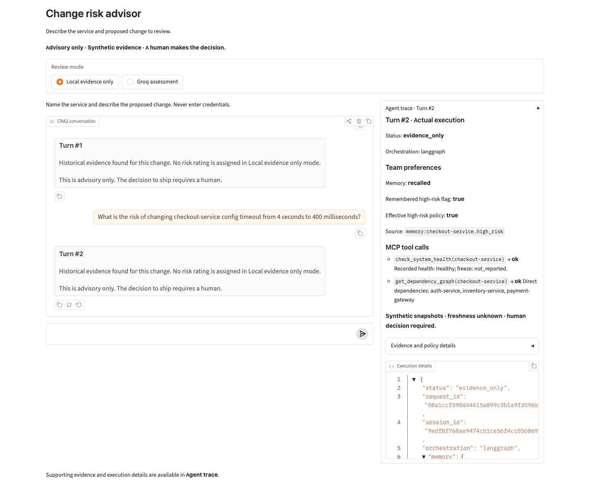
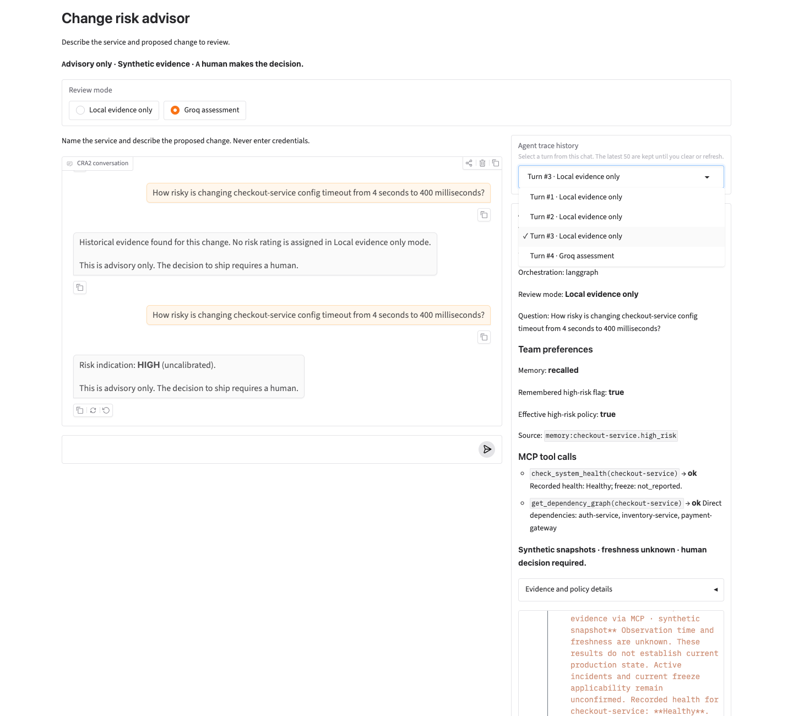
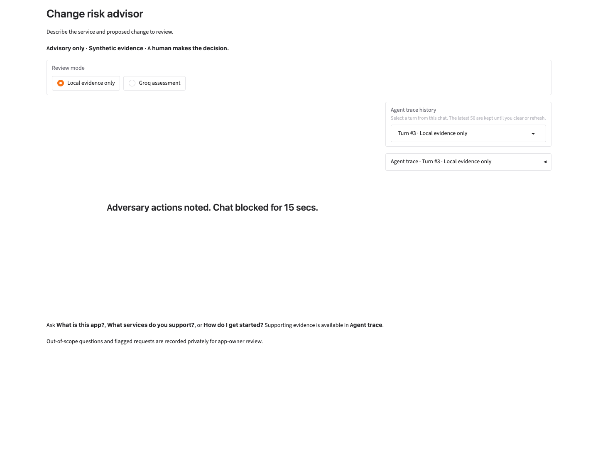
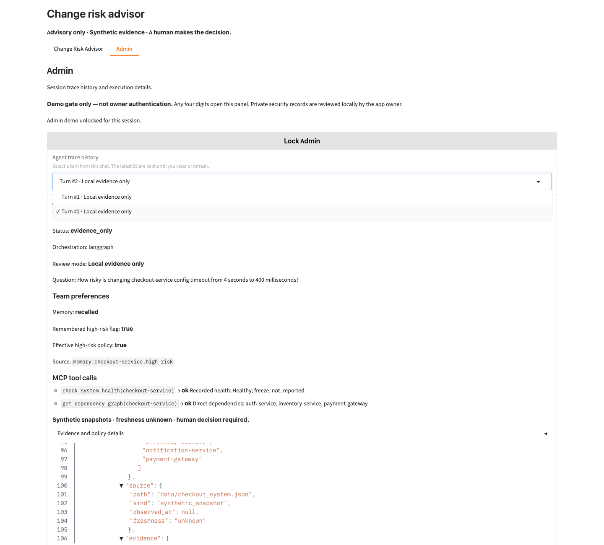

# Task 18: real Gradio/MCP/memory browser walkthrough

Executed at `2026-10-18T03:29:35.556Z` (17 Oct 2026 America/Chicago).
The actual loopback Gradio app was exercised using installed Chrome and two
independent browser contexts. External browser requests were blocked. The app
used Local evidence only; no new provider call was made.

## Session A: explicit preference write

- Browser-generated session: `df9ec8d3a64c4df49a715841892a5442`.
- Input: Remember that checkout-service is always high-risk for our team.
- Observed status: memory_saved; persisted high-risk flag true.
- No retrieval, MCP or provider work was required for this write.

## Session B: new visit, no shared chat history

- Browser-generated session: `7e8addca83e34d48b8dfac36e597ed4a`; distinct from session A.
- Before input, the new browser context contained no prior conversation.
- Input: Change checkout-service config timeout from 4 seconds to 400 milliseconds.
- Observed status: evidence_only; recalled high-risk flag true, effective flag true.
- Actual MCP calls: check_system_health(checkout-service), get_dependency_graph(checkout-service).
- Recorded health: Healthy; freeze report: not_reported, applicability unconfirmed.
- Direct dependencies: auth-service, inventory-service, payment-gateway.
- Historical passages, source IDs, snapshot uncertainty and advisory reminder
  appeared in the actual chat response.

## Expanded panel screenshot


The screenshot was inspected. An initial component placement issue had moved
chat below the trace; it was corrected before this final capture. The final
image shows the actual chat beside the expanded panel, recalled policy and
both MCP results. The JSON panel contains only the projected trace; it is not
a raw SDK/graph-state dump. Full browser transcripts remain in ignored
`week2/.local/task18-browser.json`. The test server and browser were stopped.

## Final verification

```text
Week 2: 86 passed in 30.60s
Core: 502 passed, 4 live tests deselected in 4.66s
Unchanged Week 1 tests inside Week 2 environment: 494 passed in 7.39s
Final UI layout checks: 4 passed in 4.45s
Repeated fast evaluation: 100/100, minimum rubric 10/10, 20/20 contexts repeatable
Provider attempts in final fast evaluation: 0
```

Evaluation UTC window: 2026-10-18T03:28:18.685476+00:00 to
2026-10-18T03:28:18.748985+00:00. These checks do not establish production
accuracy, multi-user authentication or current operational health.

The implementation remains local and advisory. Team identity comes from host
configuration. Storage and credentials are not served as files. Preference
records are team/service scoped; freeze notes remain inert, unverified policy
text. The existing medium floor for a high-risk policy is preserved; local
mode assigns no model risk rating. Persistent conversation history, public
sharing/deployment, and Weeks 3–4 remain outside this completion.

Launch: `week2/.venv/bin/python -m week2.app` from the repository root, then
open `http://127.0.0.1:7862`. Expand Agent trace after submitting a query.

## Presentation correction — 2026-10-18

The owner reported excessive supporting details for:
`How risky is changing checkout-service config timeout from 4 seconds to 400 milliseconds?`

Assessment replies now show only the concise outcome and advisory reminder.
Historical excerpts, source/evidence identifiers, operational snapshots and
memory/policy provenance are retained in the trace. Evidence and policy details
is collapsed separately. Validated assessment level/questions are explicit
trace fields; prompts, hidden reasoning and arbitrary provider fields are not
exported. The chat reply, accordion label, trace heading and JSON share a turn
number derived from visible user turns. Retry keeps that number; undo/clear
remove stale traces, and a fresh chat starts at one.

Verification:

- Six new regression cases failed before the fix, exposing both the detail
  leak and missing turn correlation. The final Week 2 suite passed **94 tests
  in 33.56 seconds**, including low-severity model output retaining the memory
  risk floor, projection of approved question fields, and protected fallback
  when the response catalog is unavailable. Existing tests were preserved.
- Actual Chrome, retrieval and MCP at `2026-10-18T16:35:51.625Z`: saved preference
  at turn 1, Local evidence only at turn 2, Groq-mode rendering at turn 3 using
  an **explicit offline reviewer fixture**, not a live Groq response. The
  fixture disabled provider access and marked `request_attempted=false`.
  Verified concise chat, both MCP calls, recalled memory, matching labels,
  collapsed supporting details, retry, undo, clear and a distinct fresh session.
- Restarted the actual app on port 7862, preserving its default memory store.
  At `2026-10-18T16:36:43.437Z`, two Local evidence only queries showed matching
  turns 1–2, recalled memory and both real MCP calls, with no provider request.
  Inspected the screenshot below. The app remains running; the isolated browser
  test server is stopped. Refresh an existing tab to load the updated UI.



Full reports remain ignored in `week2/.local/presentation-browser.json` and
`week2/.local/presentation-live-browser.json`. The private task 18 learner note
was updated and remains ignored. No live-provider behavior, rating policy,
MCP contracts, dependency environment, Week 1 presentation or persistent chat
history was changed.

## Session trace history and app help — 2026-10-18

The owner superseded the earlier chat badge requirement: turn numbers belong
only in Agent trace, and earlier traces must remain selectable. The previous
UI retained only its latest result; app-help requests also reached Week 1's
narrower help routing and outdated memory/tool descriptions.

The updated UI has an always-visible Agent trace history selector for the
latest 50 turns in the current browser session. Each snapshot retains its
original question, review mode, request ID and guarded execution facts.
Selecting one reads a snapshot without rerunning the graph, tools or provider.
Retry replaces the same turn, undo removes the latest turn, and clear removes
session traces. Refresh/new browser sessions start without trace history.
Durable team preferences remain separate and unchanged. Chat has no turn badge.

Week 2 now answers overview, capabilities, catalog-derived known services,
getting started, modes, preference commands, conversation/memory behavior,
trace, LangGraph/MCP and limits locally in either mode. Week 1 is unchanged.
Unrelated requests, mixed-request clarification and advisory boundaries remain.

Verification:

- The focused pre-fix run reproduced missing app help, missing trace history
  and unwanted badges: 46 failures, 4 passes. Badge assertions were changed to
  match the owner's new requirement; evidence/credential checks were retained.
- Final Week 2 gate: **147 passed in 35.72 seconds**. Tests include both-mode
  help without retrieval/MCP/provider work, catalog enumeration detecting new
  services, earlier trace selection without execution, immutable original modes,
  bounded retention, retry replacement and rejected-credential input withholding.
- Browser fixture at `2026-10-18T16:49:33.085Z`: app overview at turn 1, all eight
  known services at turn 2, real retrieval/MCP Local evidence only at turn 3,
  and Groq-mode rendering with an explicit offline reviewer at turn 4. No live
  Groq request. Selected earlier turns 1 and 3 without changing their snapshots,
  verified original Local mode while the radio was on Groq, then retry, undo,
  clear and a distinct empty session. The screenshot was inspected.
- Restarted the actual app on port 7862 and checked it at
  `2026-10-18T16:51:04.564Z`: current app help, known services, a local evidence
  question recalling team memory, no chat badges, and retrieval of the exact
  earlier snapshots for turns 1 and 2. No provider requests. The app remains
  running; the isolated offline fixture was stopped.



Detailed reports remain ignored in `week2/.local/trace-history-browser.json`
and `week2/.local/trace-history-live.json`. README and the ignored task 18
learner note describe the new behavior. This adds session-only trace retention,
not persistent conversation storage or cross-session trace restoration.

## Local abuse admission and owner-only question memory — 2026-10-18

The owner requested a collection of out-of-scope questions, a classifier for
active adversarial requests, a centered 15-second chat block, and owner-only
access to the stored questions. Ordinary unrelated questions are collected
without a block. Suspected attacks are rejected before graph, retrieval, MCP
or provider execution. Private classifier verdicts are excluded from user traces.

Implementation: frozen local BGE embeddings and fixed synthetic prototypes,
independent checks for explicit actions on protected resources, server-owned
monotonic cooldowns, a centered countdown replacing chat controls, and a separate
owner SQLite store/CLI. No new dependency or external classification request.
The default audit directory is 0700 and file 0600, checked for owner, regular
file/link safety, schema, size and row bounds. Storage/classifier failures pause
without claiming an attack. Configured credentials are withheld. Actual records
remain ignored and never enter team preferences, retrieval or model training.

Classifier evidence:

- 80 distinct synthetic rows: 48 train, 16 validation, 16 test; no missing labels
  or duplicate texts. Runtime questions never train the classifier.
- Validation selected margin 0.035 at minimum attack similarity 0.60. Frozen
  encoder: BAAI/bge-small-en-v1.5, existing pinned FastEmbed environment.
- On 16 held-out rows, the semantic model caught 7/8 attacks and allowed 8/8
  benign questions: TP=7, FP=0, FN=1, TN=8. The nearest-prototype baseline had
  one additional false positive; the majority baseline caught no attacks.
- The observed miss was an explicit credential-disclosure request. The separate
  protected-action contract rejects that request. Combined replay: TP=8, FP=0,
  FN=0, TN=8. This replay followed error analysis and is explicitly not a new
  unseen test. Similarity is not calibrated confidence or proof of user intent.
- Evaluation metadata and encoder/corpus fingerprints are in ignored
  `week2/.local/abuse-evaluation.json`. These small English synthetic samples do
  not establish production, encoded, multilingual, multi-turn or novel coverage.

Verification:

- Final Week 2 gate: **169 passed in 35.44 seconds**. Includes protected-action
  versus educational intent, cooldown/no extension/client separation, private
  persistence/readback, permission failures, existing-file/symlink refusal,
  credential withholding, unavailable/malformed classifier, audit failures,
  no agent execution after block, and no private verdict in projected traces.
- Actual browser on the restarted user app at
  `2026-10-18T17:36:38.930Z`: ordinary unrelated question allowed; security
  learning question allowed; semantic-classifier canary blocked; centered
  "Adversary actions noted. Chat blocked for 15 secs." notice; chat controls
  hidden; automatic recovery after 15,484 ms; subsequent known-services help
  succeeded. No Groq request.
- New browser session with a spoofed X-Forwarded-For header remained blocked.
  The direct loopback app disables forwarded-header trust. The private SQLite
  file returned HTTP **403**. The screenshot was inspected.
- Owner readback found two persisted synthetic demonstration records, one
  out-of-scope and one suspected-adversarial. The flagged event records that
  the semantic classifier ran. Confirmed 0600 file and 0700 directory. The
  isolated fixture also passed CLI readback; no question contents were printed
  into verification output. The owner CLI is:
  `week2/.venv/bin/python -m week2.owner_audit --limit 50`.



Reports remain ignored in `week2/.local/abuse-browser.json` and
`week2/.local/abuse-live-browser.json`. The updated app remains running on port
7862 and the temporary block has expired. The isolated fixture is stopped.

Limits: peer-IP cooldowns affect windows/users sharing that address; this local
demo does not establish authenticated user identity or distributed rate limits.
Owner-only means OS-account/file permissions and no browser read endpoint,
not a production role system, encryption or tamper-proof/WORM logging. Existing
tool contracts and file-serving restrictions remain independent of detection.

## Admin trace panel — 2026-10-18

The owner requested an Admin panel beside Change Risk Advisor and moving trace
history and its controls there. After clarification, they explicitly selected
**any four digits as a demo-only gate**. There is no configured, hardcoded or
saved password. The field is masked and cleared after either validation result;
it is not passed to chat, the graph, the provider, team preferences or owner
audit. This gate does not authenticate an owner.

The two adjacent tabs separate the conversation from trace selection, original
turn/mode labels, evidence/policy details and execution JSON. Snapshots remain
in server-side Gradio State while locked. All trace-producing UI callbacks
project empty details/choices when locked; a hidden populated widget would not
meet this boundary. Actual Gradio preprocessing/serialization rejects forged
client State values and emits null for the server-only snapshot output. Unlock
reveals this session's history; Lock clears rendered details and retains the
snapshots. Refresh starts locked and empty. Previously delivered browser data
cannot be revoked, and anyone can unlock with four digits. Private security
records/classifier verdicts remain local-CLI-only, outside Admin.

The raw semantic classifier flagged two legitimate Admin navigation questions.
A bounded whole-question navigation contract handles those after credential
and prohibited-action checks. Appended adversarial instructions still receive
the existing guard. No encoder, corpus, threshold or held-out classifier metric
was changed; these observed navigation false positives further limit the older
synthetic evaluation's coverage.

Verification:

- Final Week 2 gate: **196 passed in 44.49 seconds**, including server-side
  serialization, forged state, input validation/clearing, locked projections,
  navigation and appended-action cases, and existing history/agent protections.
- Chrome fixture at `2026-10-18T18:50:34.514Z`: four saved turns across local
  and Groq modes; actual retrieval and both stdio MCP tools; recalled memory;
  masked/cleared input; invalid input rejected; arbitrary four digits accepted;
  earlier snapshots unchanged; lock/reveal; independent empty sessions; no
  chat turn badges. Groq rendering used the explicit offline reviewer fixture,
  with `request_attempted=false`. No new provider request.
- Chrome lifecycle at `2026-10-18T18:51:02.129Z`: retry replaced its turn, undo
  removed it, clear reset trace history/numbering while preserving preferences,
  a flagged request hid chat for **15,677 ms**, and recovery was automatic.
  Admin showed only the protected blocked trace, with input withheld and no
  private classifier verdict. No provider request.
- Final running app at `2026-10-18T18:51:18.940Z`: Admin navigation succeeded
  without a pause; local assessment recalled persistent preferences and called
  both actual MCP tools; turns 1 and 2 remained selectable; Admin started
  locked; the private audit file returned **403**. The screenshot was inspected.



Reports are ignored in `week2/.local/admin-browser.json`,
`admin-lifecycle-browser.json` and `admin-live-browser.json`. The task 18 learner
note remains ignored. The actual app is running on port 7862; refresh an existing
tab to load the tabs. The temporary fixture is stopped. No new dependencies,
live provider calls, publishing or unrelated document changes were made.

## Admin notes removed — 2026-10-18

Removed both owner-selected notes: the demo disclaimer paragraph and unlocked
status sentence. Routine status is hidden; invalid PIN feedback remains.
The gate and trace controls are unchanged. Focused checks: **22 passed in
9.90 seconds**. Chrome on the restarted app at `2026-10-18T19:15:28.266Z`
confirmed both notes absent and validation/unlock/lock working, with no provider
request. Private report: `week2/.local/admin-notes-browser.json`.
