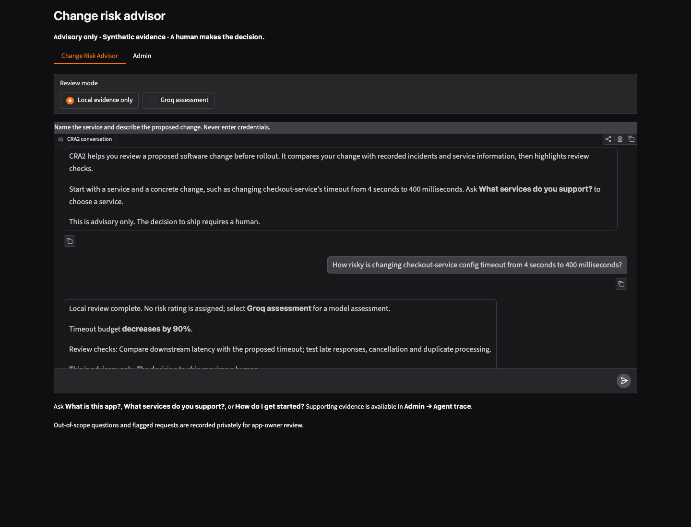

# Useful change-review answers

Date: 2026-10-18 (America/Chicago). Browser proof: 2026-10-19T04:34:28.986Z.

The owner reported a long app overview, generic replies for specific timeout
and retry changes, and an unhelpful clarification for an unspecified downstream
request-handling change. The owner explicitly kept Local evidence only as the
browser default.

## Result

- The overview explains the purpose and gives a concrete starting point,
  without listing Admin or execution controls.
- Local change replies include bounded facts from the supplied values and
  practical review checks. The 4-second to 400-millisecond example identifies
  a 90% lower timeout budget; retry changes identify the configured counts and
  checks for peak-load amplification, backoff and duplicate handling. These
  checklists are review recommendations, not retrieved incident facts or
  claims that those checks have already run.
- Local mode still performs retrieval and both MCP calls, makes no provider
  request, and assigns no model risk rating. It explains how to select Groq
  assessment when a model indication is wanted.
- Groq presentation retains the validated policy-adjusted rating and adds at
  most two short validated public review questions. Hidden reasoning, raw
  passages, tool dumps, source identifiers and policy provenance remain in
  their existing protected locations.
- Vague changes ask for the missing setting or behavior and include a concrete
  before/after example. They do not invent an assessment.
- Slack shares this presentation. No Slack trace viewer, durable chat history,
  new dependency or provider contract was introduced.

## Verification

The new regression file first reproduced seven failures and three passing
boundary checks. After the correction, 76 focused presentation/help checks
passed. The full Week 2 suite then passed 239 tests in 58.62 seconds. A final
numeric-formatting refinement added two edge cases to avoid rounding a tiny
nonzero change to zero, or a nearly complete reduction to 100%; the nearest
affected presentation and Slack gate passed all 53 tests in 17.91 seconds.
Existing tests were preserved.

A fresh real Chrome session exercised the owner's five browser turns:
overview, timeout, retries, and the repeated vague question. It verified the
default mode, useful checks, targeted clarification, absent chat diagnostics,
and both actual MCP calls in the selected Turn #2 trace. Retrieval was real;
the provider integration was tested with an explicit offline reviewer. No
live Groq call or Slack test message was sent.

The owned web app and Slack listener were restarted after the checks. The web
app serves loopback port 7862; Slack completed its live Socket Mode startup.
Team memory and the private owner audit were preserved. Runtime files and the
browser report remain ignored under `week2/.local/`; the task learner note
remains ignored under `private-learning/`.

## Publication checks — 2026-10-27

The complete current Week 2 suite passed **241 tests in 74.51 seconds**.
Unchanged core checks passed **502 tests** with four live cases excluded;
Week 1 passed **494 tests**. The fast calibration gate passed **100/100
assessments**, with a minimum rubric score of 10/10 and 20/20 decision contexts
repeatable across five runs. These checks made no provider request.

The publication selection covers Week 2 implementation, tests and supporting
evidence. Private learner notes, dotenv files, databases, runtime logs and
virtual environments remain excluded. Screenshots show synthetic demo inputs.
Configured credential and workspace/channel values were checked against the
selected files and outgoing Git content with a positive detection canary.
This is a bounded configured-value check, not a claim of general secret coverage.
