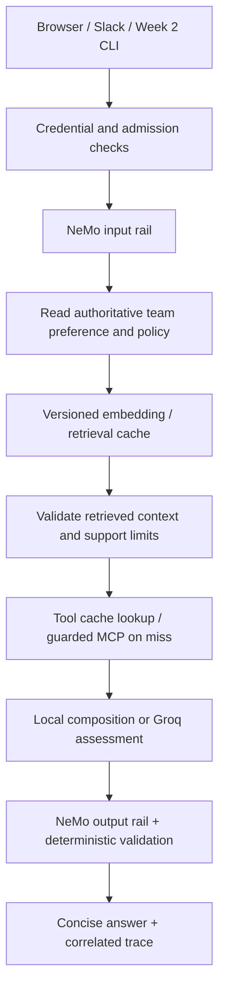

# Design and estimates: CRA2 Weeks 3–4

Status: proposal for mentor/owner review, not implemented. Baseline `49487b1`.
Planning measurements collected on 2026-10-28 UTC / 2026-10-27 local time.

## Guardrail placement

Keep LangGraph as the orchestrator. Integrate NVIDIA NeMo Guardrails at explicit
input, retrieved-context and output boundaries through its Python SDK and
registered local actions. Keep MCP contract/argument/result checks in the host
and server. NeMo does not replace tool authorization, credential checks, input
bounds, policy precedence or provenance validation.

Initially use local custom rail actions so Local evidence only retains its
zero-provider-call contract. Any model-based self-check is a separate opt-in
design with its own provider, payload authorization, latency and token budget.
Do not label an offline double or an unused YAML file as a NeMo integration.
Pin the actually resolved version after a compatibility spike with the current
Python, LangGraph, Pydantic and FastEmbed environment. Preserve the existing
encoder fingerprint; don't silently rebuild the index to accommodate a package.

Rules cover requirements W1-R01/R04/R05/R06/R07 and W2-R02/R03/R04/R06/R07:
advisory only; no operational approval/decision/execution; evidence needed for
claims; no invented health, freeze, active incidents or edges; current policy
wins; safe errors; no credentials in prompts/logs/cache. Preserve supported app
help and benign out-of-scope behavior. Missing/failed safety checks fail closed.
Structured rail events use bounded M0–M4 verdicts. Untrusted user, retrieved,
tool and memory text never becomes a system instruction.

The existing exact two-tool metadata gate remains the reviewed substitute for
the unavailable Sentinel integration. It is not a general semantic poisoning
detector. Retain discovery and pre-invocation checks on actual MCP calls.
An expired or rejected cache entry must not bypass the host contract.

Citation membership alone cannot establish semantic support. A payment TLS
incident does not prove a timeout failure. Evaluation must explicitly test
this distinction; any semantic support gate needs labeled validation and a
held-out set. Do not advertise complete hallucination prevention.

For a request combining approval language and a sufficiently detailed change,
decline approval and continue only the permitted assessment. A bare approval
request gets a boundary response or clarification. App help stays local.

## Cache design: freshness, validity and eviction are separate

Start with bounded in-process caches plus existing SQLite persistence. Redis
is deferred until multiple replicas require shared hit rates or coordinated
invalidation. Never add semantic answer caching initially: 400 ms and 4 ms
must remain different changes.

| Data | Proposed initial reuse rule | Invalidating dependency |
|---|---|---|
| Persisted passage embeddings | Content-addressed; no correctness TTL | Chunk text, embedding artifacts, preprocessing/chunking version |
| Query embedding | Exact text + encoder identity; 24 h retention, size bounded | Text/model/preprocessing change |
| Top-k retrieval results | 5 min retention, exact query/filter/k | Corpus digest, index/encoder version, retrieval configuration |
| Current synthetic health/graph tool results | Source hash required on every reuse; 5 min retention | Fixture content hash, tool implementation/contract version, arguments |
| Future live health | Illustrative 15 s maximum, subject to source freshness SLA | Source expiry/version/event, observed age, error or explicit invalidation |
| Future live dependency graph | Illustrative 5 min maximum, subject to topology SLA | Topology version/change event, source expiry, contract version |
| Team preference/policy | Read authoritative state each request initially | Every saved preference/configuration change |
| Final Groq assessment | Disabled initially | Future key must cover every assessment dependency |

The proposed times are starting design choices, not measured freshness promises.
Embeddings for identical text and model artifacts do not become semantically
stale after 24 h; their retention limit controls memory. Synthetic source hashes
establish identity, not current production truth. Cache insertion time is not
the source observation time; keep `observed_at=null` and `freshness=unknown`.

For a live source, agree on maximum accepted observation age A, determine its
age a at fetch, and set reuse to at most `min(configured_TTL, A-a, source_time_left)`.
Reject negative/unknown budgets for claims requiring fresh state. Source update
events invalidate early; TTL is the backstop when an event is missed. Use an
absolute monotonic expiry, not a sliding expiry that can keep hot stale data
alive indefinitely. Never serve stale health/permission/policy after an error.

A future assessment key is a hash of canonical data containing tenant/team
scope, resolved service, exact change and numbers, mode, effective policy and
memory revision, corpus/index/encoder identity, evidence content, tool result
versions and deadlines, prompt/model/generation settings, schema and guardrail
configuration. Validate current dependencies before lookup and again before
inserting/serving an in-flight result. A policy/source change during generation
invalidates that result. Request/turn IDs are fresh trace context, not cache
identity. Store validated evidence/results, not an old complete trace.

Implement per-key single-flight with bounded waits; do not hold a global lock
across work. Failed, malformed or rejected results are not cached. Validate on
hit as well as insertion. Cache hits emit `cache_result`, not fabricated MCP
`tool_result` executions. Record original fetch time, source version, entry age,
expiry and cache-layer identity. Clearing a team preference also invalidates
dependent entries immediately; TTL alone is insufficient.

Start with 1,024 entries and a 16 MiB byte budget per cache, then tune using
measured occupancy. An entry count alone does not bound variable graph/text
sizes. Cross-team or cross-authorization reuse is forbidden unless the host
explicitly establishes a common public synthetic scope.

## Evaluation and observability

Create a Week 3–4 six-intent scorecard separately from the 20 core calibration
cases. Cover detailed checkout risk, similar incidents, freeze uncertainty,
payment dependents, separate-session preference recall, and approval refusal.
Add held-out cases for absent mechanism support, exact numeric distinctions,
corpus/tool failure, unknown/ambiguous services, benign help, injected context,
metadata changes, cross-team isolation, and cache correctness.

Measure routing/clarification correctness, retrieval relevance at 3 and
mechanism support, cited factual support, refusal recall and benign false
positive rate, policy enforcement, cache hits/expiry/invalidation, tool failure
rate, latency p50/p95, and actual provider attempts/tokens. Report denominators,
versions and unknowns. Use human labels for quality gold cases; model judges
are supplementary and separately identified. Fix thresholds on validation,
then freeze the held-out cases before scoring. Don't tune on the test set.

Use fresh-process, same-team memory sessions and a different-team control.
Separate uncached/cold runs, cache-warm runs and provider runs. Each repeat is
scored; repeatability of a cached response is not fresh model quality. Use
injected clocks for expiry tests rather than sleeps. A 100% baseline is not
permission to invent failures or lower the rubric: report zero quality delta
and independently measured operational gains if that is the actual result.

All events share a host request/trace ID, with spans for memory, retrieval,
cache, actual tools, rails, provider and output. Log stage timing, protected
status/error codes, counts, source/version references and byte sizes. Never
log hidden reasoning, credentials, raw provider objects or private owner audit
questions in general telemetry. Stable pseudonymous scope IDs are still
access-controlled data. Aggregate metrics use low-cardinality labels; trace
IDs and user IDs belong in records, not metric labels.

Browser trace history remains session-scoped and bounded to 50 turns. Keep
Slack traces out of Admin. A browser dashboard can show its transport's real
aggregates; owner security records keep their separate local access path.
The four-digit demo gate is not production authentication. No telemetry
export destination is implicitly authorized by this plan.

## Measured footprint at baseline

Method: all 8 catalog services x both real read-only Python tool functions;
JSON encoded as compact UTF-8. SDK envelopes were built using actual MCP types.
One explicit payment timeout question also ran the real local RAG and MCP
workflow in Local evidence only mode. No provider request was made. Its trace
included response details, question, mode and turn, matching the browser shape.
See [sizing-measurements.json](sizing-measurements.json). These are serialization
measurements, not a packet capture, memory profile or throughput benchmark.

| Item | Measured bytes |
|---|---:|
| Tool arguments across all services | 31–39 |
| Health structured result | 390–416 |
| Dependency structured result | 443–529 |
| Health MCP SDK result envelope | 930–982 |
| Dependency MCP SDK result envelope | 1,045–1,230 |
| Two-tool discovery response | 4,202 |
| Three discovery responses per two-tool batch | 12,606 |
| Both SDK tool result envelopes, conservative summed range | 1,975–2,212 |
| One actual enriched browser-shaped trace | 4,920 |

The client checks inventory after initialization and before each invocation.
Discovery plus result bodies total approximately 14.6–14.8 KB per uncached
two-tool batch, excluding initialization, request messages, JSON-RPC wrappers
and transport overhead. Metadata dominates this small fixture; this is not a
reason to remove its security gate. Tool descriptors are not currently sent
to Groq; the assessment receives validated structured tool outputs.

The 64 KiB JSON guard is a validation ceiling for individual checked values,
not a typical payload. The combined workflow bundle has a guard too; two
individually valid large results do not automatically fit a valid bundle.
The current 68 x 384 float32 passage vectors occupy 104,448 bytes before text,
SQLite and runtime overhead. One million such vectors would occupy 1.536 GB
before metadata/index overhead; exact full scans need re-benchmarking there.

## Back-of-envelope scale model

Assumptions, not observed traffic: 10,000 daily users x 20 eligible questions
= 200,000 requests/day; 10x peak-to-average; two tools per question; 50% of
questions request Groq. All sizes below use decimal KB/MB/GB. Help, clarification
and one-tool routes would reduce tool demand; rails may add work/calls.

- Average request rate: `200000 / 86400 = 2.31 requests/s`; peak: `23.15/s`.
- Logical tool lookups: `2 x 200000 = 400000/day`; actual MCP invocations depend
  on each tool cache hit rate. At a hypothetical common 80% hit rate, 80,000
  tool invocations/day remain. One-tool misses still have discovery overhead.
- With assessment caching disabled, `200000 x 0.5 = 100000` Groq assessments/day.
  Only a future measured 20% assessment hit rate would reduce that to 80,000.
  Model-based guardrails add separate calls and tokens; don't hide those in hits.
- At peak and an assumed 2 s mean provider duration, uncached Groq concurrency
  is `23.15 x 0.5 x 2 = 23.15`. This is capacity arithmetic, not a latency test.
  Actual MCP child concurrency is arrival rate x MCP batch duration, not the
  entire model duration; add admission/semaphore limits and finite queue waits.
- Without tool cache hits, discovery bodies alone total about 2.52 GB/day.
  Current text-plus-structured MCP output duplicates the serialized result;
  this wire volume differs from bytes persisted in a compact trace.
- One thousand active browser sessions x 50 retained traces x 4,920 bytes
  is approximately 246 MB of serialized trace content, before Python, Gradio
  and browser-object overhead. The single-process demo is not a scale proof.

Proposed storage budgets: 2 KB compact metadata per request retained for 30
days; 8 KB detailed redacted traces, sampled at 10%, retained for 7 days.
The 8 KB detail budget allows room above this one 4.9 KB baseline; it is not a
worst-case bound. Define explicit bounded fields/truncation indicators and
measure tails before enforcement.

- Metadata: `200000 x 2000 = 400 MB/day`, or 12 GB for 30 days.
- Sampled details: `200000 x 0.1 x 8000 = 160 MB/day`, or 1.12 GB for 7 days.
- Combined retained content: about **13.12 GB**, excluding indexes, replicas,
  compression and additional failure/security traces. Three copies alone would
  be 39.36 GB before storage/index overhead.
- Retaining every 8 KB detail instead would produce 1.6 GB/day of details;
  keeping every current 4,920-byte trace would produce 984 MB/day.

Keep all compact security/failure verdicts and use bounded redacted diagnostic
detail for failures, adding their actual rate to the budget. Security verdicts
need an access-controlled append-only/tamper-evident retention design; a local
SQLite store is not WORM storage. Current owner audit stops at 10,000 rows or
64 MiB; at an assumed 2,000 audited events/day, row capacity is about five days.
Plan archival/rotation and full-disk behavior before a scale claim. No existing
audit records are deleted by planning or routine tests.

## Sources

- [Pinned upstream tasks](https://github.com/abhineer/Sep-Projects/blob/3e52f28ae1f430211d2df6098ab366f38ebdb86e/ChangeRiskAdvisor/tasks.md), tasks 19–34; read via raw source when the page fetch failed.
- [NVIDIA rail types](https://docs.nvidia.com/nemo/guardrails/about-nemo-guardrails-library/rail-types): available guardrail boundaries.
- [NVIDIA application integration](https://docs.nvidia.com/nemo/guardrails/get-started/integrate-into-application): SDK integration and LangChain opt-in/version considerations.
- [NVIDIA configuration evaluation](https://docs.nvidia.com/nemo/guardrails/evaluation/evaluate-configuration): compliance, resource use and latency evaluation.
- [NVIDIA memory model cache](https://docs.nvidia.com/nemo/guardrails/configure-guardrails/caching/model-memory-cache): separate exact-prompt/LFU model cache. It does not define CRA2's policy/source freshness contract.

Library documentation was checked during planning. Pin/version-check the actual
dependency at implementation; these links may evolve. All numerical TTLs,
traffic assumptions, retention budgets and proposed file choices are this
design's proposals, not vendor guarantees.

## Local delivery acceptance refinement — 2026-10-31

The owner selected a local demo with complete evidence. The design remains
proposed; these criteria refine its execution and acceptance.

- Week 3 closes with actual NeMo execution, all six local intent contracts,
  safe approval/unsupported-evidence handling, measured repeated graph-query
  reuse, expiry/invalidation/isolation checks and real UI badges. Approval plus
  a concrete change must decline the decision and continue permitted review.
  A bare approval request may offer help or clarification instead.
- Week 4 closes the selected local scope with correlated traces, versioned
  cases/scorer, retained baseline, categorized failures, comparable rerun, a
  dashboard reached from chat, triggered failures and a timed rehearsal from
  documented launch instructions. Local task-34 acceptance is distinct from
  pending upstream deployment/video requirements. An agent fresh-process run
  is not an independent teammate's acceptance.
- Local results assess behavior and evidence presentation, not live model
  quality. Offline reviewer doubles prove adapter integration only. Scores
  remain separate by mode; no live provider batch is implicit in local scope.
- Separate the six contract cases, labeled development/validation cases used
  for fixes, and reserved quality cases. Freeze case IDs, inputs, labels,
  scorer and source versions before baseline. A case inspected to select a
  fix becomes regression evidence, not independent held-out proof. Run reserved
  cases after choices are frozen; disclose any later tuning on those cases.
- Blocking failures include operational approval/action, unsupported rating,
  invented facts, credential exposure, cross-team leakage, stale policy/source
  reuse, bypassed tool gates and continuing after a required safety check fails.
  Require zero observed failures in the enumerated acceptance cases, reporting
  denominators and limits rather than claiming universal protection.
- Benchmark at least 30 local dependency-query trials per condition after
  separately reported startup/warmup: cache disabled, enabled-empty, warm and
  expired/invalidated. Keep query/source/runtime versions comparable. Retain
  raw timings, actual RPC counts, hit denominators and p50/p95. If reuse is
  slower, investigate before task 23 acceptance; do not hide unfavorable runs.
- Task 30 retains the upstream improvement criterion. If baseline is already
  perfect or a justified fix does not improve it, report zero delta and propose
  owner-reviewed acceptance of preserved quality plus observed operational
  gains. Do not manufacture failures or silently waive the original criterion.
- Add minimal rail/cache events during Week 3 and reuse the current request ID
  and trace. Task 26 completes spans and bounded persistence; avoid a parallel
  tracing system. Preserve Slack adapters with offline tests, read-only
  preferences and no Slack traces in browser Admin; send no real messages.

NVIDIA's [rail-types documentation](https://docs.nvidia.com/nemo/guardrails/about-nemo-guardrails-library/rail-types)
was rechecked on 2026-10-31 for input/retrieval/output boundaries. Package
compatibility and zero-provider custom-action execution still require task
20's spike; this documentation review does not select a package version.
