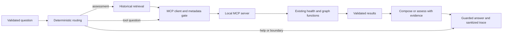

# Week 2: LangGraph, MCP, team memory and Gradio trace

Run from the CRA2 repository root. Tasks 15–18 are implemented. The Week 2 app
uses the guarded graph, actual MCP calls and persistent team preferences.

## Start the chat

```sh
week2/.venv/bin/python -m week2.app
```

Open `http://127.0.0.1:7862`. The default is Local evidence only: no provider
request or model risk rating. Expand **Agent trace** to inspect actual calls,
recalled settings, provenance and protected failures. Team identity is trusted
host configuration; it is not a user-editable field. The app binds to loopback,
uses no public tunnel, disables analytics and does not restore conversations.

Try these in order:

1. `Remember that checkout-service is always high-risk for our team.`
2. Open a new browser session, then ask: `Change checkout-service config timeout from 4 seconds to 400 milliseconds.`
3. Expand Agent trace: the recalled flag and both MCP calls should be present.
4. `Remember freeze policy for checkout-service: Verify the team calendar.`

Preferences persist in ignored `week2/.local/team-memory.sqlite3`. Use
`Forget the high-risk preference for checkout-service.` to explicitly clear a
stored flag. This never lowers an authoritative configured risk floor. A
freeze note is inert policy text, never proof of an active freeze.

## Tool-only engineering entry point

```sh
uv sync --locked --project week2 --python 3.13
uv run --locked --project week2 python -m week2 'What services depend on payment-gateway?' --trace
uv run --locked --project week2 python -m week2 'Is checkout-service current health okay?' --trace
```

These queries cross a real stdio MCP boundary and need no retrieval model or
provider. The graph uses the reviewed two-tool inventory; it does not expose
arbitrary servers or commands.

## Full assessment path

The existing Week 1 local model/index can be reused: FastEmbed is pinned to
0.8.1 to preserve that encoder identity. If this is a fresh clone, provision
the checksum-pinned model and build the local index explicitly:

```sh
uv run --locked --project week2 python -m week1.setup_index --download-model
```

Then run without a provider:

```sh
uv run --locked --project week2 python -m week2 'Change checkout-service config timeout from 4 seconds to 400 milliseconds.' --trace
```

The default is **Local evidence only**: three retrieved passages, both MCP
tools, and no model risk indication. Pure tool queries skip retrieval entirely.
Ask for one exact service. An unspecified freeze question requests a service
rather than inferring one.

`--mode 'Groq assessment'` opts into the existing protected Groq provider
adapter. It sends the change, retrieved passages, configured policy and MCP
results to Groq. The owner explicitly authorized one such assessment for task 15;
that live verification succeeded. This does not authorize unrelated or recurring
provider calls. Provider failures preserve tool evidence
and produce no model risk indication. Never put credentials in arguments or
chat text; use the existing explicitly selected ignored dotenv configuration.

## Execution and trust boundaries



- `workflow.py`: explicit `StateGraph`, bounded routes and ephemeral state.
  Existing Week 1 modules own retrieval, policy and historical assessments.
- `contracts.py`: exact reviewed names/descriptions/schemas, argument/result
  validation, provenance and service checks. This bounded gate substitutes for
  the unavailable Sentinel skill; it is not a general tool-poisoning detector.
- `mcp_client.py`: discovery, revalidation before each call, at most two unique
  calls, a 12-second default deadline, and subprocess cleanup. Partial outputs
  are discarded after a transport/metadata failure.
- `mcp_server.py`: exactly two read-only tools. No provider or UI credentials
  are passed to the child. Stdout carries protocol messages only.
- `responses.json`: configurable Week 2 presentation copy, complementing the
  unchanged Week 1 response catalog.

Every successful result is labeled **synthetic snapshot**. Observation time,
freshness and active incidents stay unknown; freeze applicability stays
unconfirmed. An actual call does not establish current production state.
Unknown service/source and protocol failures remain protected errors.

The workflow passes tool facts and evidence identifiers into the reviewer.
Combined citations are checked at the Week 2 boundary; the existing adapter
continues checking historical citations and policy floors. The UI-facing
answer renders validated tool facts separately with their evidence identifiers.
Model prose is not exposed as independent operational truth.

LangSmith tracing is explicitly disabled for this workflow, including when the
environment enables it. Raw graph state is not the exported trace. No persistent
graph checkpointer, conversation store or external telemetry is introduced.
Task 16 adds a bounded preference database; task 17 loads it before assessment;
task 18 projects actual events into the Gradio panel.

## Verify

```sh
uv run --locked --offline --project week2 python -m pytest week2/tests -q
```

Tests exercise actual MCP subprocesses, metadata mutation between discovery and
invocation, malformed results, known/unknown services, unavailable sources,
deadline cleanup, input/output credentials, both tools reaching the assessment
payload, and unchanged policy/advisory behavior. Provider/retrieval doubles in
offline tests are labeled separately from actual protocol and local-index runs.

[Task 15 evidence](../docs/evidence/week2-task-15.md) ·
[Task 16 readback](../docs/evidence/week2-task-16.md) ·
[Task 17 recall](../docs/evidence/week2-task-17.md) ·
[Task 18 browser proof](../docs/evidence/week2-task-18.md).
