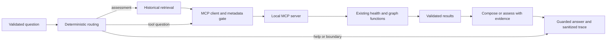

# Week 2: LangGraph, MCP, team memory and Gradio trace

Slack integration is available as a separate local Socket Mode process. Use
`/cra` or the dedicated public `#cra` channel for a service picker and questions.
See [Slack setup and walkthrough](SLACK.md) for the new-app manifest, ignored
credential configuration and launch instructions. Workspace installation/live
delivery require the owner's setup; the web app stays on its existing port.

Run from the CRA2 repository root. Tasks 15–18 are implemented. The Week 2 app
uses the guarded graph, actual MCP calls and persistent team preferences.

## Start the chat

```sh
week2/.venv/bin/python -m week2.app
```

Open `http://127.0.0.1:7862`. The default is Local evidence only: no provider
request or model risk rating. Assessment replies show a concise outcome,
change-specific facts and review checks; source
IDs, passages, tool results and memory/policy provenance stay in **Admin →
Agent trace**. Open **Admin** beside **Change Risk Advisor**, enter any four
digits, then select **Unlock Admin**. This is the explicitly chosen demo gate,
not owner authentication: there is no fixed password, enrollment or saved PIN.
The masked input clears after submission and never enters chat, traces, owner
records or a provider request. Session traces remain in server-side Gradio
State while locked; trace callbacks return empty details and choices until
the session is unlocked. **Lock Admin** clears rendered details while retaining
the session snapshots. Private owner security records remain local-CLI-only.

The Admin **Agent trace history** selector keeps the latest 50 turns
in this browser session. Each entry shows its original Local evidence only or
Groq assessment mode. Select an earlier turn to inspect its question and results
without rerunning the agent. Turn numbers appear only in the trace, not chat.
Retry replaces the same turn; undo removes it; clear removes session traces.
A refresh starts a fresh, locked session. Expand **Agent trace** in Admin to inspect actual calls,
recalled settings, provenance and protected failures. Team identity is trusted
host configuration; it is not a user-editable field. The app binds to loopback,
uses no public tunnel, disables analytics and does not restore conversations.

App help is local in either mode. Ask **What is this app?**, **What services do
you support?**, **What can you do?**, **How do I get started?**, **How do I save a
preference?**, or ask about modes, tools, memory, trace history and limitations.
Known services come from the current catalog. Help does not call retrieval,
MCP or Groq; unrelated requests remain outside scope.
Whole Admin navigation questions such as **Where is the Admin tab?** have a
bounded benign contract because the existing semantic classifier otherwise
flags them. This does not admit appended actions or change classifier training.

## Private out-of-scope collection and abuse cooldown

Chat requests are screened locally before agent execution. A fixed collection
of 80 synthetic examples supports the installed BGE semantic classifier;
explicit protected-resource actions have a separate contract check. Ordinary
unrelated questions are privately recorded without a block. Flagged requests
hide chat controls, show a centered 15-second countdown, and restore chat
automatically. Clear/refresh/new sessions do not reset the server cooldown.
This loopback demo keys cooldowns to the connecting peer address, so browser
windows sharing that address share the pause. Forwarded headers are not trusted.

Actual questions/verdicts are kept separately from team memory in ignored
`week2/.local/owner-private/questions.sqlite3`. Its directory is 0700 and file
0600, owned by the app's OS account. The owner reads it locally, not through a
browser/admin endpoint:

```sh
week2/.venv/bin/python -m week2.owner_audit --limit 50
```

Owner records never enter retrieval, user traces or training. Known configured
credentials are withheld. Insecure, unavailable, corrupt or full storage and
unavailable/malformed classifier results fail closed with a temporary pause;
they do not accuse the user of an attack. The store is capped at 10,000 events
and 64 MiB; it does not silently delete old records. No new dependency or
external classification request is introduced.

Detection is best-effort. The semantic model caught 7/8 adversarial held-out
examples with 0/8 benign false positives; the independent protected-action
check catches the observed credential-request miss. The combined replay is
not a new unseen test. These synthetic results do not establish production
coverage, user intent, or resistance to encoded/multilingual/multi-turn attacks.
Owner-only access means OS account/file permissions plus blocked HTTP access;
this is not a production role/authentication system. Model provisioning uses
the existing explicit Week 1 setup if local weights are missing.

Reproduce the synthetic evaluation without exposing owner records:

```sh
week2/.venv/bin/python -m week2.evaluate_abuse --out week2/.local/abuse-evaluation.json
```

Try these in order:

1. `Remember that checkout-service is always high-risk for our team.`
2. Open a new browser session, then ask: `Change checkout-service config timeout from 4 seconds to 400 milliseconds.`
3. Open Admin, enter any four digits, then expand Agent trace: the recalled flag and both MCP calls should be present.
4. `Remember freeze policy for checkout-service: Verify the team calendar.`

Inside the trace, **Evidence and policy details** contains the guarded supporting
response, and **Execution details** contains the selected structured facts,
validated assessment questions and outcome. These are evidence and execution
details, not hidden model reasoning or a raw graph-state dump. The primary UI
does not display implementation instructions or example preference commands.

Preferences persist in ignored `week2/.local/team-memory.sqlite3`. Use
`Forget the high-risk preference for checkout-service.` to explicitly clear a
stored flag. This never lowers an authoritative configured risk floor. A
freeze note is inert policy text, never proof of an active freeze.

## Tool-only engineering entry point

```sh
uv sync --locked --project week2 --python 3.13
uv run --locked --project week2 python -m week2 'What services depend on payment-gateway?' --trace
uv run --locked --project week2 python -m week2 'Is checkout-service current health okay?' --trace
```

These queries cross a real stdio MCP boundary and need no retrieval model or
provider. The graph uses the reviewed two-tool inventory; it does not expose
arbitrary servers or commands.

## Full assessment path

The existing Week 1 local model/index can be reused: FastEmbed is pinned to
0.8.1 to preserve that encoder identity. If this is a fresh clone, provision
the checksum-pinned model and build the local index explicitly:

```sh
uv run --locked --project week2 python -m week1.setup_index --download-model
```

Then run without a provider:

```sh
uv run --locked --project week2 python -m week2 'Change checkout-service config timeout from 4 seconds to 400 milliseconds.' --trace
```

The default is **Local evidence only**: three retrieved passages, both MCP
tools, and no model risk indication. Pure tool queries skip retrieval entirely.
Ask for one exact service. An unspecified freeze question requests a service
rather than inferring one.

`--mode 'Groq assessment'` opts into the existing protected Groq provider
adapter. It sends the change, retrieved passages, configured policy and MCP
results to Groq. The owner explicitly authorized one such assessment for task 15;
that live verification succeeded. This does not authorize unrelated or recurring
provider calls. Provider failures preserve tool evidence
and produce no model risk indication. Never put credentials in arguments or
chat text; use the existing explicitly selected ignored dotenv configuration.

## Execution and trust boundaries



- `workflow.py`: explicit `StateGraph`, bounded routes and ephemeral state.
  Existing Week 1 modules own retrieval, policy and historical assessments.
- `contracts.py`: exact reviewed names/descriptions/schemas, argument/result
  validation, provenance and service checks. This bounded gate substitutes for
  the unavailable Sentinel skill; it is not a general tool-poisoning detector.
- `mcp_client.py`: discovery, revalidation before each call, at most two unique
  calls, a 12-second default deadline, and subprocess cleanup. Partial outputs
  are discarded after a transport/metadata failure.
- `mcp_server.py`: exactly two read-only tools. No provider or UI credentials
  are passed to the child. Stdout carries protocol messages only.
- `responses.json`: configurable Week 2 presentation copy, complementing the
  unchanged Week 1 response catalog.

Every successful result is labeled **synthetic snapshot**. Observation time,
freshness and active incidents stay unknown; freeze applicability stays
unconfirmed. An actual call does not establish current production state.
Unknown service/source and protocol failures remain protected errors.

The workflow passes tool facts and evidence identifiers into the reviewer.
Combined citations are checked at the Week 2 boundary; the existing adapter
continues checking historical citations and policy floors. The UI-facing
answer renders validated tool facts separately with their evidence identifiers.
Model prose is not exposed as independent operational truth.

LangSmith tracing is explicitly disabled for this workflow, including when the
environment enables it. Raw graph state is not the exported trace. No persistent
graph checkpointer, conversation store or external telemetry is introduced.
Task 16 adds a bounded preference database; task 17 loads it before assessment;
task 18 projects actual events into the Gradio panel.

## Verify

```sh
uv run --locked --offline --project week2 python -m pytest week2/tests -q
```

Tests exercise actual MCP subprocesses, metadata mutation between discovery and
invocation, malformed results, known/unknown services, unavailable sources,
deadline cleanup, input/output credentials, both tools reaching the assessment
payload, and unchanged policy/advisory behavior. Provider/retrieval doubles in
offline tests are labeled separately from actual protocol and local-index runs.

[Task 15 evidence](../docs/evidence/week2-task-15.md) ·
[Task 16 readback](../docs/evidence/week2-task-16.md) ·
[Task 17 recall](../docs/evidence/week2-task-17.md) ·
[Task 18 browser proof](../docs/evidence/week2-task-18.md).
